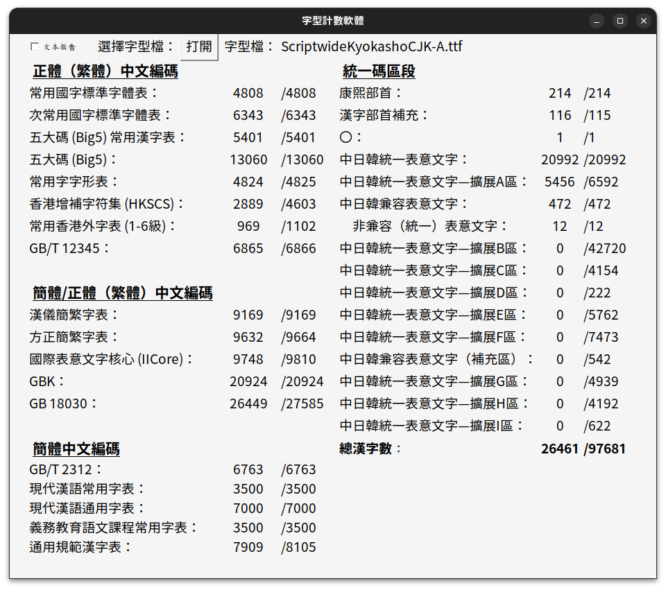
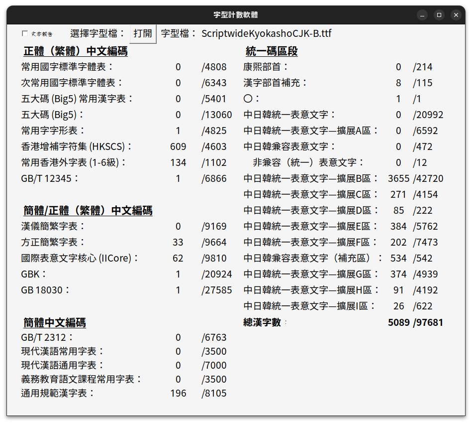

# Scriptwide Kyokasho CJK

CJK font based on Klee One Semibold and its derivatives

This font is licensed under OFL.

## Description

Low effort amalgamation of several Klee One-derived fonts with some minute edits.

Glyphs do not necessarily follow any source, but most of them should follow the J-source or G-source.

## Coverage

These are screenshots from <https://github.com/NightFurySL2001/CJK-character-count>.

## Bragging

Note that most glyphs are NOT made by me. Only additions and planned ranges are shown.

*: next update

- [x] CJK URO
- [ ] CJK Ext-A
- [ ] G3 / GB/T 13131
- [ ] G5 / GB/T 13132 (BMP)
- [ ] G5 / GB/T 13132 (non-BMP)
- [x] G7 / Data Statistics Table of Hanzi not included in GB/T 2312—1980 and other "fake" G7 characters
- [x] GK / GB/T 12052-1989
- [x] GS / Singapore Characters
- [x] HKSCS (BMP)
- [ ] HKSCS (non-BMP)
- [x] MSCS (BMP)
- [ ] MSCS (non-BMP) and M-source horizontal extensions (MD)
- [ ] T3 (BMP)
- [ ] T3 (non-BMP)
- [x] J1 / JIS X 0212
- [x] K0 / KS X 1001
- [x] K1 / KS X 1002
- [x] K2 / KS X 1027-1
- [ ] K3 / KS X 1027-2
- [ ] KP1 / KPS 10721 (BMP)
- [ ] KP1 / KPS 10721 (non-BMP)
- [x] VN (Ext-A)

## Who asked?

1. Why does Scriptwide Kyokasho CJK consist of several fonts?
  * One font file can only support 65535 glyphs, so the font has to be split to accommodate future additions. The `Misc` fonts are also provided solely for LGC display.
2. What does each font do?
  * `CJK-A` covers CJK characters in the BMP, `CJK-B` covers CJK characters elsewhere, `CJK-P` covers PUA characters, and `Misc` and `Misc-Mono` cover LGC characters. Due to their smaller file sizes, WOFF and WOFF2 files are provided for the `Misc` and `Misc-Mono` fonts.
  * `CJK-A` also includes regional variants. However, they should not be relied on.
3. Is this README file copied from Scriptwide Sans CJK?
  * Yes.
4. Can I expand on this font?
  * You may do so as long as you follow the terms of the OFL.
5. Aren't there less characters compared to LXGW WenKai?
  * Those are AI placeholder characters produced through zi2zi. To increase quality and to avoid confusion, they have been removed. Newer glyphs may still be traced from these AI characters.
6. Why isn't this classified as a Kai font?
  * This is to differentiate the font from other Kai fonts like TW-Kai. Contrary to popular belief, Klee One is more similar to kyokasho-tai compared to the Kai script. However, kyokasho-tai itself is based on Kai script.
7. Your font sucks.
  * I know.
8. This section sucks.
  * I know.

## Disclaimer

This is not a professional font.

Glyphs do not necessarily follow any source.

I am not responsible for any damages caused by misusage of this font, or any misunderstandings that may arise when it is used in any scenario.

If there are inaccuracies in certain glyphs, please create an issue.

## License

As stated above, these fonts are licensed under the Open Font License. Details can be found in [the license file](LICENSE) or [the OFL website](https://openfontlicense.org/).

This portion is partially taken from [the Plangothic repository](https://github.com/Fitzgerald-Porthmouth-Koenigsegg/Plangothic_Project/blob/main/README.en.md#license) and from the OFL website.

Note that the below is not a substitute for legal advice. Please refer to the OFL text for more details.

### You may:

* Install these fonts.
* Modify these fonts.
* Redistribute these fonts, modified or not. (Please ensure the modified font is licensed under the OFL, and does not use any OFL reserved names. Scriptwide itself is NOT a reserved name, but to prevent confusion, I do not recommend using the "Scriptwide" name in any derivative fonts.)
* Use these fonts for all kinds of design work, both commercial and non-commercial, free of charge, without notice or acknowledgement. (Though, credit is still appreciated.)

### You may not:

* Sell any part of the font files on their own.
  * There are many online merchants (typically on Taobao) illegally reselling OFL fonts. No matter the original creator of the fonts, please refrain from purchasing from these resellers, as sellings fonts directly is a serious violation of the OFL.
* Republish these fonts under a license that is not compatible with the OFL.
  * 鼎〇 (〇猎), I'm talking about you...

## Credits

| Font | Brief Description | Author(s) |
| --- | --- | --- |
| [Klee One](https://fonts.google.com/specimen/Klee+One) | Base font of base font | Fontworks |
| [LXGW WenKai](https://github.com/lxgw/LxgwWenKai) | Base font | LXGW |
| [LXGW WenKai TC](https://github.com/lxgw/LxgwWenkaiTC) | Provided classical glyphs | LXGW |
| [LXGW WenKai KR](https://github.com/lxgw/LxgwWenkaiKR) | Provided some glyphs | LXGW |
| [LXGW WenKai GB](https://github.com/lxgw/LxgwWenkaiGB) | Provided some glyphs | LXGW |
| [Pengli](https://github.com/lxgw/Pengli) | Provided glyphs from GB/Z 40637-2021 | LXGW |
| [ChienChia](https://github.com/Tsao-Tung/Chienchia) | Provided modifications of Pengli glyphs | Tsao Tung |
| [Chisuga-Shotai](https://github.com/ChisugaMaeka/Chisuga-Shotai) | Provided some glyphs | ChisugaMaeka |
| [YshiPen-Shuti](https://github.com/Steve-Yuu/YshiPen-Shuti) | Provided classical glyphs | Steve Yuu |
| [Moon Stars Kai](https://github.com/GuiWonder/MoonStarsKai) | Provided classical glyphs | GuiWonder |
| [Iansui](https://github.com/ButTaiwan/iansui) | Provided some glyphs | But Ko |
| [JyunsaiKaai](https://github.com/ItMarki/jyunsaikaai) | Provided some glyphs | ItMarki |
| [PlanKai](https://github.com/Des-Magmeta/PlanKai) | Provided some glyphs | Des-Magmeta |
| [WenKai_MSARG](https://github.com/buwuzhengyedexiaoji/WenKai_MSARG) | Provided some glyphs | buwuzhengyedexiaoji |
| [Astalia](https://github.com/Ayaginu-Sue/Astalia) | Provided some glyphs | Ayaginu-Sue |
| [Ysabeau](https://github.com/CatharsisFonts/Ysabeau) | Provided some glyphs (sans-serif circled numbers) | Catharsis Fonts |
